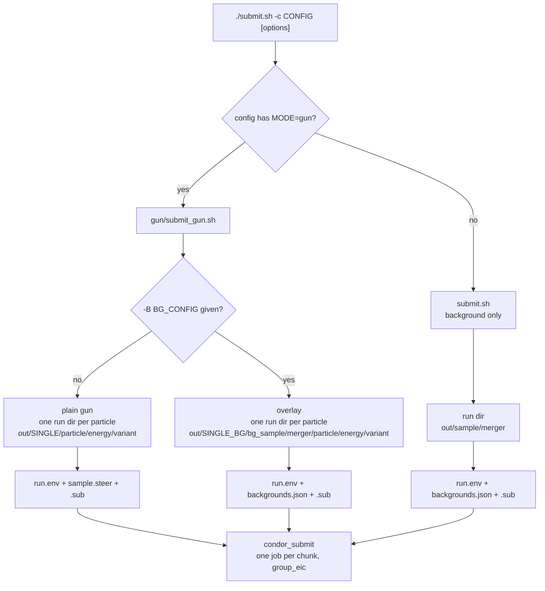
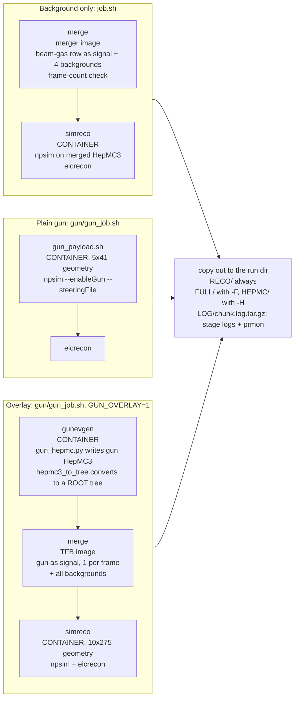
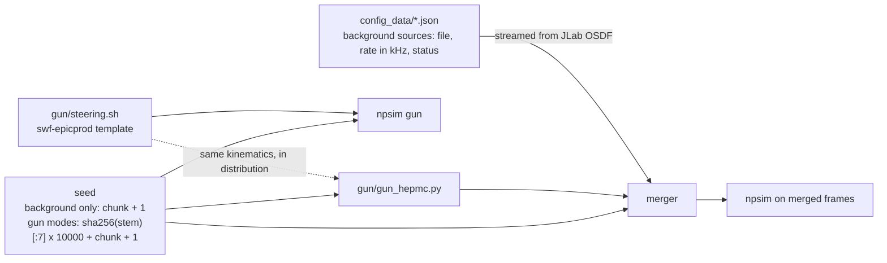

# bnl-epic-condor-test

ePIC simulation and reconstruction as local HTCondor jobs on BNL SDCC
(`group_eic`). The jobs skip PanDA and Rucio: inputs stream from the JLab
OSDF door, and outputs land on GPFS. The steps follow the epicprod payload
(swf-epicprod `swf_epicprod/payload/run.sh`).

There are three modes, and each one is picked by the config:

| Mode | Config | Each event is |
|---|---|---|
| Background only | `configs/allbg_*.env` | one 2 µs frame of every beam background at its real rate, with no physics signal |
| Particle gun | `configs/singles_*.env` (`MODE=gun`) | one gun particle, the swf-epicprod singles steering |
| Gun + background overlay | a gun config with `-B configs/allbg_*.env` | one gun particle plus one frame of every background |

## Run it with Claude Code (recommended)

The repo includes a Claude Code skill,
[`epic-condor-run`](.claude/skills/epic-condor-run/SKILL.md), that knows
how to run everything here. You don't need to learn the scripts first:

    git clone https://github.com/rahmans1/bnl-epic-condor-test.git
    cd bnl-epic-condor-test            # on GPFS, from an SDCC submit node
    claude

Then say what you want in plain words:

- *"Run 50k pi+ and 50k neutrons at 20 GeV, theta 1 to 4 degrees."*
- *"Same guns, but overlay the 10x275 backgrounds."*
- *"Make a new config for 10 GeV electrons at 3 to 50 degrees and test it."*
- *"How are my jobs doing? Resubmit any failed chunks."*
- *"Check the RECO output: is the gun particle there with the right angles?"*

Claude picks the mode and config, does a dry run, tests one small chunk
on the submit node, and only then submits the full run. After that it
monitors the jobs, checks the outputs and resubmits failures. It asks you
before changing physics settings, memory requests or removing jobs.

**Use it to learn the commands.** Every step is an ordinary bash command
that Claude shows you before running it, so you can watch, copy and reuse
them without Claude. Ask for that directly:

- *"Show me the commands for a 20 GeV pi+ gun run, step by step, and explain each flag. Don't run anything."*
- *"Write a shell script I can rerun myself for this configuration."*
- *"What does `-B` change in the job, and which files does it write?"*

The skill file itself is a short, readable runbook: mode choice, dry run →
local test → full run, monitoring, output checks and failure handling. The
sections below are the full reference.

## Quick start (by hand)

From an SDCC submit node (e.g. `eicsub01`), with the repo on GPFS. The jobs
read the scripts from where they sit and mount only `/gpfs02`:

    # background only: 100 jobs x 100 frames, SignalBackgroundMerger
    ./submit.sh -c configs/allbg_10x275_gold10um.env -n 100 -f 100

    # particle gun: 50k each of pi+ and neutron, 20 GeV, 1-4 deg, 5x41
    ./submit.sh -c configs/singles_20GeV_1to4deg.env

    # the same gun with the 10x275 backgrounds overlaid
    ./submit.sh -c configs/singles_20GeV_1to4deg.env -B configs/allbg_10x275_gold10um.env

    # any mode: -d writes the run directory and .sub file without submitting
    ./submit.sh -c configs/singles_20GeV_1to4deg.env -e 20 -n 2 -o test-out -d

`./submit.sh -c <bg config>` with no other arguments prints the options of
background-only mode. `gun/submit_gun.sh` with no arguments prints the gun
options.

## Workflow

### Submission

`submit.sh` reads the config, picks the mode, and writes one run directory
per sample: one per particle in the gun modes. The run directory's
`run.env` is the only input the job reads besides the scripts, so a chunk
can be rerun from it at any time.

### One job (one chunk)

Every step runs in an `apptainer exec --cleanenv` container on the worker's
scratch disk. Only the outputs are copied back to the run directory. A
chunk whose RECO file already exists exits at the first step.

### Inputs and seeds

The background skips are rate-scaled and seed-mixed, as in run.sh, so
each chunk reads a different slice of each background file.

## Configuration

A config is a sourced bash file. Keys:

| Key | Modes | Meaning |
|---|---|---|
| `SAMPLE` | background | Sample name; the run directory is `out/SAMPLE/merger`. |
| `SOURCES_JSON` | background, overlay (`-B`) | Background sources: `file`, `freq` (kHz), `status` offset. |
| `SIGNAL_ROW_STATUS`, `SIGNAL_NEVENTS` | background | The source row used as the merger's "signal", and its file's event count. |
| `CONTAINER` | all | Image for npsim and eicrecon (and the gun files). |
| `HEPMCMERGER_CONTAINER`, `TFB_CONTAINER` | background, overlay | Merger images. SignalBackgroundMerger defaults to `CONTAINER`. |
| `MERGER_PATH` | background, overlay | Directory put first on `PATH` for the merge step (a patched TimeFrameBuilder). |
| `DETECTOR_VERSION`, `DETECTOR_CONFIG`, `EBEAM`, `PBEAM` | all | Geometry `DETECTOR_CONFIG_EBEAMxPBEAM.xml`. In overlay these come from the background config. |
| `INTEGRATION_WINDOW` | background, overlay | Frame length in ns (2000). |
| `MODE=gun` | gun | Sends the config to `gun/submit_gun.sh`. |
| `GUN_PARTICLES` | gun | Geant4 names, space separated (`pi+ neutron`). |
| `GUN_ENERGY` | gun | Total energy with unit (`20*GeV`). |
| `GUN_THETA_MIN`, `GUN_THETA_MAX` | gun | Polar range in degrees, detector frame; `cos(theta)` flat. |
| `GUN_EVENTS` | gun | Events per particle; sets the default chunk count. |
| `EVENTS_PER_CHUNK`, `OVERLAY_EVENTS_PER_CHUNK` | gun | Events per job for the plain gun (2000) and the overlay (100). |

## Exit codes

| Code | Meaning |
|---|---|
| 82 | Overlay: the gun HepMC3 file was not written. |
| 83 | No geometry file for the requested beams. |
| 84 / 85 | Plain gun: npsim / eicrecon produced no output. |
| 86 | The merger binary is missing from the merger image. |
| 87 | The merged file is missing or has the wrong frame count. |
| 89 | Copying the outputs back to GPFS failed. |

## Layout

| Path | What it is |
|---|---|
| `submit.sh` | Entry point. Writes the run directory and the `.sub` file, then calls `condor_submit`. A `MODE=gun` config is handed to `gun/submit_gun.sh`. |
| `job.sh`, `bgmix_payload.sh` | Background-only Condor executable and its steps: `merge`, `simreco`, `extract` (benchmark), and `gunevgen` (overlay). |
| `gun/` | Gun mode. `submit_gun.sh`, `gun_job.sh`, `gun_payload.sh`, `steering.sh` (the swf-epicprod steering template), `gun_hepmc.py` (the gun as HepMC3, for the overlay), and `hepmc3_to_tree.cc` (ASCII to ROOT tree). |
| `mergers/` | The production merger adapters, copied unchanged from swf-epicprod `swf_epicprod/payload/mergers/` (3b8cef0). |
| `configs/` | One sample per file. |
| `config_data/` | Campaign background-source JSONs, from eicweb `EIC/campaigns/datasets`. |
| `tools/` | `status.sh`: RECO count, Condor states and failed stages for each run directory. `check_reco.py`: gun particles and background counts per event in a RECO file. |
| `.claude/skills/epic-condor-run/` | Claude Code skill: how to run, test, monitor and check jobs with this repo. |
| `bench/` | The merger benchmark (SignalBackgroundMerger vs TimeFrameBuilder) and the TimeFrameBuilder memory study. |

## Monitoring and checking

    tools/status.sh [OUT_BASE]                       # RECO written / chunks, Condor idle/run/held, failed stages
    apptainer exec --cleanenv -B /gpfs02,/gpfs/mnt/gpfs02 \
      /cvmfs/singularity.opensciencegrid.org/eicweb/eic_xl:26.07.3-stable \
      python3 tools/check_reco.py <RECO file> [max_events]   # gun PDG/theta/|p|/time and status counts per event

With Claude Code, just ask: *"check my jobs"* (see
[Run it with Claude Code](#run-it-with-claude-code-recommended)).

## Output and resubmission

Each run directory holds `run.env`, the `.sub` file, the Condor logs
(`condor/`), `RECO/`, and `LOG/` (stage logs and prmon output, one tarball
per chunk). With `-F` it also gets `FULL/` (edm4hep), and with `-H`,
`HEPMC/` (merged frames). Where the run directory goes:

- Background only: `out/<sample>/<merger>/`
- Gun: `out/SINGLE/<particle>/<energy>/<min>to<max>deg/`, the same layout as production's EVGEN/SINGLE
- Overlay: `out/SINGLE_BG/<bg sample>/<merger>/<particle>/<energy>/<min>to<max>deg/`

A chunk whose RECO file already exists exits at once, so resubmitting a
whole range fills in only the failed chunks. `-s` extends a run. A run
directory refuses to be extended with a different configuration (chunk
size, image, merger, sources, steering). Use another `-o` for that.

## Background-only mode

    ./submit.sh -c CONFIG -n CHUNKS [-f FRAMES] [-s FIRST] [-M hepmcmerger|timeframebuilder] [-m MB] [-F] [-H] [-X] [-d]

- **Merge:** the merger takes one signal and up to four backgrounds. The
  proton beam-gas row (status 6000) becomes the "signal" at its real rate.
  The other four sources (SYNRAD 2000, brems 3000, Coulomb 4000, Touschek
  5000) stay backgrounds.
- **Signal blocks:** neither merger wraps the signal file, so each chunk
  reads its own block of signal events (mean + 6σ + 10). `submit.sh`
  refuses a range that would run past `SIGNAL_NEVENTS`.
- **Flags:** background skips, seeds (chunk + 1), status offsets and the
  npsim/eicrecon flags are the same as in run.sh.
- **Merger choice:** `-M hepmcmerger` runs SignalBackgroundMerger in
  `CONTAINER` (26.07.3), the production default. `-M timeframebuilder`
  runs `timeframe_builder` 0.9.2 in `TFB_CONTAINER` (26.11.0; the first
  image that has it is 26.08.0). Simulation and reconstruction run in
  `CONTAINER` in both cases, with the same seeds, so chunk N of one merger
  pairs with chunk N of the other.
- **`-X`:** the merge-only benchmark (`bench/README.md`).

## Gun mode

    ./submit.sh -c configs/singles_*.env [-n CHUNKS] [-e EVENTS] [-p "PARTICLES"] [-s FIRST] [-m MB] [-F] [-d]

- **Steering:** the swf-epicprod template, line for line (`evgen_generate.py`
  `gun_steering()`, angle-range branch, 5fddcb9). A `cos(theta)` gun between
  `GUN_THETA_MIN` and `GUN_THETA_MAX` degrees, at total energy `GUN_ENERGY`
  (mass included), from the origin along +z in the detector frame. npsim
  runs it with `--runType run --enableGun --steeringFile`.
- **Seeds:** as in run.sh, `(sha256(stem)[:7] * 10000 + chunk + 1) mod (2^31-1)`.
  Each particle and each chunk get their own stream, the same one production
  would draw for the same stem.
- **Geometry:** `DETECTOR_CONFIG_EBEAMxPBEAM`. Singles use 5x41, as in production.
- **Chunks:** `GUN_EVENTS` per particle in chunks of `EVENTS_PER_CHUNK`
  (2000, production's gun `events_per_job`).

## Gun + background overlay (`-B`)

    ./submit.sh -c configs/singles_*.env -B configs/allbg_*.env [-M timeframebuilder|hepmcmerger] [-e FRAMES] [-H] ...

- **Gun events:** `gun/gun_hepmc.py` writes the chunk's gun particles with
  the template's kinematics. They match the npsim gun in distribution, but
  not event for event. Each event has one vertex at the origin: the
  incoming beams (status 4, the background config's energies, no crossing
  angle) and the outgoing gun particle (status 1). TimeFrameBuilder drops
  a particle that has no vertex.
- **File format:** the script writes HepMC3 ASCII, because pyHepMC3's
  ROOT-tree writer segfaults in 26.07.3. TimeFrameBuilder reads only
  `.hepmc3.tree.root`, so `gun/hepmc3_to_tree.cc` (compiled in the job in
  about 3 s) converts the file.
- **Gun time:** TimeFrameBuilder places the gun at a random time within
  the 2 µs frame, the same way it places the backgrounds, so the
  particle's `MCParticles.time` is not 0.
- **Merge:** the gun is the merger's signal at frequency 0, so exactly one
  per frame. Every source of the background config is a background. The
  10x275 config has five sources, more than SignalBackgroundMerger takes,
  so the default merger is `timeframebuilder`. It uses `tfb-patched/build`
  if that exists (below) or `MERGER_PATH` if set. `-M hepmcmerger` works
  only with four or fewer sources.
- **Geometry:** the background config's beams (10x275), because the
  backgrounds are beam-specific. 5x41 has no background set.
- **Seeds:** the gun's per-stem seed drives the gun kinematics, the
  background skips and Geant4.
- **Cost:** each frame carries about 26k SR photons, so a frame costs far
  more than a bare gun event. `OVERLAY_EVENTS_PER_CHUNK` (100) sets the
  chunk size.

## TimeFrameBuilder status and the patched build

The production payload treats TimeFrameBuilder as validation only. The
benchmark against 0.9.2 (`bench/README.md`) found:

- **Physics:** merged frames are statistically identical to
  SignalBackgroundMerger's, and both read the same input events in the
  same order.
- **Fixed in 0.9.2:** the double event-index advance, and skips beyond the
  end of a file.
- **Still open:** multi-file sources reread their first file (not used
  here). A source without repeat that runs out exits 0 with short output;
  the frame-count check catches this (exit 87).
- **Memory leak:** stock 0.9.2 leaks memory every time a background file
  repeats, about 11 MB per frame here. Above about 250 frames per job that
  passes 6 GB. Use the patched build, or keep stock TFB to about 100 frames
  per job.

The fix is commit `f8bba31` on branch `fix/hepmc3-close-reader-on-reopen`
of `eic/TimeframeBuilder`, also in `bench/memory/tfb-close-reader.patch`.
Build it inside the repo (`tfb-patched/` is gitignored) and in
`TFB_CONTAINER`, because it links against that image's libraries:

    git clone -b fix/hepmc3-close-reader-on-reopen https://github.com/eic/TimeframeBuilder.git tfb-patched
    cd tfb-patched
    apptainer exec -B /gpfs02,/gpfs/mnt/gpfs02 \
      /cvmfs/singularity.opensciencegrid.org/eicweb/eic_xl:26.11.0-stable bash -c \
      "cmake -S . -B build -DCMAKE_BUILD_TYPE=Release -DTIMEFRAME_BUILDER_VERSION=0.9.2 && cmake --build build -j8"

Then pass `MERGER_PATH=$PWD/tfb-patched/build` (environment or config).
Overlay mode picks it up on its own. The build peaks at 1.9 GB at 500
frames, and its output is bit-identical to stock 0.9.2. `MERGER_PATH` is
part of a run directory's identity, so use a new `-o` when switching between
the stock and patched builds. A job's `condor/<chunk>.out` shows
`merger from <MERGER_PATH>`.

When an image ships the fix, point `TFB_CONTAINER` at it, drop `MERGER_PATH`,
and confirm with `./submit.sh -c ... -n 3 -f 500 -M timeframebuilder -X -o bench/runs/check`.
Peak PSS should be about 2 GB, not about 8 GB. Test the memory rather than
trusting the version string.

## Tested

- **Background only, 2026-11-05.** 10x275, 2 chunks × 2 frames per merger
  (clusters 320654-320656); every job exited 0.
  - About 9 min per chunk. npsim took 3.3 min and eicrecon 1.4 min; the merge took 12-14 s once the JLab door was warm.
  - Peak PSS: eicrecon 2.6 GB, npsim 2.3 GB, merger 1.1 GB.
  - SYNRAD primaries per frame: 26,632 / 26,613 with hepmcmerger and 26,419 / 26,814 with TFB, against about 26,554 expected.
  - A rerun reproduced hepmcmerger chunk 1 exactly, so the seeds are deterministic.
- **Plain gun, 2026-11-16.** 5x41, 1 chunk × 3 pi+ events, run with
  `gun/gun_job.sh` on eicsub01. 3 events of PDG 211 with θ 3.18°, 1.76° and
  3.44° and E = 20.000 GeV. npsim took 2.2 min and eicrecon 1.0 min.
- **Overlay, 2026-11-16.** 10x275, TimeFrameBuilder 0.9.2 stock, 1 chunk ×
  2 neutron frames. Each frame had exactly one status-1 neutron (θ 1.96° and
  3.98°, |p| 19.978 GeV, t 653 ns and 1512 ns), its 2 status-4 beams,
  about 26.4k SR photons (2001) and 12-16 brems particles (3001). The merge
  took 12 s, npsim 2.1 min and eicrecon 0.8 min.

## Caveats

- **SYNRAD reuse:** the gold 10 µm SYNRAD file holds about 31 frames of
  photons, so every frame reuses the same 832k-photon pool.
- **10x100 sources:** the 10x100 JSON uses the 10x275 SYNRAD, Coulomb and
  Touschek files, as the campaign does.
- **Signal events:** `SIGNAL_NEVENTS` (10M) is confirmed for the 275 GeV
  proton beam-gas file. The 100 GeV file was not checked.
- **Skip overflow:** SignalBackgroundMerger silently mishandles background
  skips above 2³¹−1 (HEPMC_Merger 2.4.0 `PrepData(int skip)`). For SYNRAD
  this starts after about 81,000 frames. TimeFrameBuilder takes 64-bit skips.
- **eicrecon errors:** eicrecon logs "No beam electrons/protons found" in
  frames with no physics signal. This is expected; the jobs still succeed.
